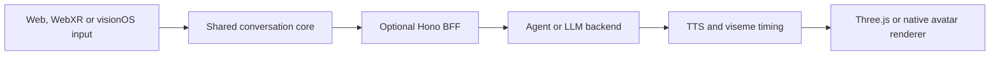
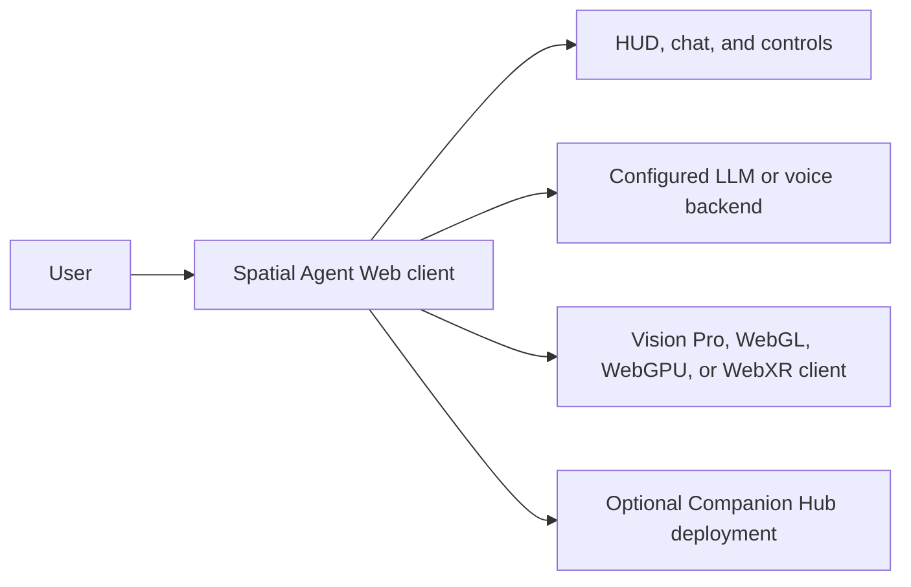

<p align="center">
  
</p>

<h1 align="center">CI Spatial Companion</h1>

<p align="center"><strong>WebXR and WebSpatial</strong></p>

[](https://github.com/companionintelligence/Companion-Avatar/releases)
[](https://github.com/companionintelligence/Companion-Avatar)
[](LICENSE)
[](https://discord.com/invite/yQp9hwpzAa)

<p align="center"><a href="#documentation">Documentation</a> · <a href="#build-targets">Build targets</a> · <a href="#test-with-a-backend">Test with a backend</a> · <a href="#publishing">Publishing</a> · <a href="#license">License</a> · <a href="https://docs.ci.computer/docs/reference/open-source-systems">Systems map</a></p>

<p align="center">
  <a href="#docker--ci-hub"></a>
</p>

Embodied AI Avatar framework with WebXR and Vision Pro support.

## Documentation

**Start here — system reference** (how it all works, with mermaid charts):

| Doc | What it covers |
|---|---|
| [architecture.md](docs/architecture.md) | The embodied agent end-to-end — pipeline, conversation-turn sequence, `useAgent` service graph, platform/render tiers, deployment |
| [animation.md](docs/animation.md) | The body **animation mixer**, the full clip/expression library (33 GLB + 7 feminine + 6 VRMA), and **how the LLM triggers animations** |
| [avatar.md](docs/avatar.md) | Avatar **rig contract**, the viseme + emote face systems, facial capability tiers, the 24-avatar catalog, and the HumGen→VRM pipeline |
| 🎞 [**Visual-test gallery**](docs/visual-tests/) | **98 animated WebP clips** across 6 avatars (male + female · GLB + VRM, incl. the **feminine motion set** on female avatars) in sub-pages — [body animations](docs/visual-tests/animations.md), [faces](docs/visual-tests/faces.md) (lip-sync + emotes), [eye movement](docs/visual-tests/eyes.md), [blend combos](docs/visual-tests/blends.md) — rendered inline on GitHub |

**Pipelines & plans:**

| Doc | What it covers |
|---|---|
| [ANIMATION-PIPELINE.md](docs/ANIMATION-PIPELINE.md) | The body-animation pipeline + the RPM/Mixamo clip library |
| [AVATAR-PIPELINE.md](docs/AVATAR-PIPELINE.md) | Avatar pipeline + the rig contract in depth |
| [VOICE-PIPELINE.md](docs/VOICE-PIPELINE.md) | STT → LLM → TTS voice pipeline + lip-sync (VibeVoice / CosyVoice) |
| [FACIAL-ANIMATION-PLAN.md](docs/FACIAL-ANIMATION-PLAN.md) | Tiered facial animation (VRM → ARKit → FACS → **MetaHuman** roadmap) |
| [WEBSPATIAL-PLAN.md](docs/WEBSPATIAL-PLAN.md) | WebSpatial / spatial-platform support (visionOS, Android XR, Pico) |
| [TESTING-PIPELINE.md](docs/TESTING-PIPELINE.md) | The 5-layer test strategy (unit → visual WebP → E2E) |
| [PUBLISHING.md](docs/PUBLISHING.md) | Where each build ships (stores, Snap, Homebrew, Scoop, winget), what is ready, and what only the owner can supply |
| [DEVICE-QA.md](docs/DEVICE-QA.md) | The 2026-11-24 run of web, desktop, iOS and Android against a backend, with its findings |
| [operations/error-reporting.md](docs/operations/error-reporting.md) | Opt-out Sentry crash reporting — how to turn it off, what is scrubbed, and why prompts/replies can never reach it |
| [ASSET-PIPELINE.md](docs/ASSET-PIPELINE.md) · [DEPLOYMENT.md](docs/DEPLOYMENT.md) · [DRIVE-ASSETS.md](docs/DRIVE-ASSETS.md) · [PRODUCT-PLAN.md](docs/PRODUCT-PLAN.md) · [BUTTON-AUDIT.md](docs/BUTTON-AUDIT.md) | Asset packaging · container deployment · owned-asset inventory · product/launch plan · control-bar audit |

## Interface

The app is a full-viewport **3D avatar viewport** with a 2D HUD — logo, chat-log
panel, chat input, and a floating control dock — composited on top. The shell is
intentionally **dark-only**: it is an XR HUD, not a light-themable document
surface, so the canon dark background (`--teal-950` `#041620`) is kept even under a
light OS preference. It is on the [Companion Intelligence design system](https://github.com/companionintelligence/CI-Common/tree/main/styles):
phthalo `--primary` (`#0a6358` / dark `#c5e8dc`) and Manrope, sourced from the shared
`:root` / `.dark` tokens in `packages/core/src/styles/globals.css`. The design system
ships both light and dark palettes; this XR HUD deliberately renders the **dark**
tokens only.

All screenshots below are the **real UI rendered headlessly** (WebGL via
`chrome-headless-shell`/SwiftShader). With no LLM/TTS backend configured the app
falls back to the offline scripted (`script`) LLM provider, so the avatar, control
dock, and chat conversation all render out of the box — no backend needed for any
screen here. XR (AR/VR) session entry and speech audio require a headset / native
runtime and are **not** exercised in these captures (the dock reports
`XR: unavailable` under headless Chromium); see the note at the end of this section.

### First-run onboarding

The microphone-permission modal shown on first load (before `ci_avatar_onboarded`
is set in `localStorage`), layered over the live avatar scene. "Skip" drops
straight into text chat.


### HUD shell

The default state once onboarding is dismissed: the Companion Intelligence logo, the
VRM avatar, the collapsible **Chat Log** panel (empty), the floating control dock,
and the live `XR:` status line.


### Chat conversation

The **Chat Log** populated by a real exchange with the offline scripted provider —
`You` / `Assistant` bubbles rendered with the canon teal gradient. No LLM backend
is running; the responses come from the bundled directed-response set.


### Controls collapsed

With the control dock hidden via its **Controls** toggle (bottom-left), the HUD
reduces to the logo, Chat Log, and the exposed `Type your message here…` chat
input — the minimal text-only interaction surface.


> **Backend / native-runtime-gated surfaces (not captured):** entering an immersive
> **AR/VR session** requires a WebXR-capable headset (the 🥽 / 📱 dock buttons and
> the XR recenter/scale/exit controls only activate inside a session), the **Vision
> Pro** WebSpatial build (`apps/vision-pro`) needs visionOS, and **voice** (mic VAD →
> STT → TTS lip-sync) and **cloud/WebGPU** modes need device permissions or a
> reachable backend. Those states are not fabricated here; only what genuinely
> renders headlessly is shown.

## Structure

```
├── packages/
│   ├── core/           # Shared services, components, and utilities
│   ├── engine/         # Rigs, facial animation, lip-sync, motion and conversation
│   └── agent/          # Agent memory and tools
├── apps/
│   ├── web/            # React/R3F standard web application
│   ├── desktop/        # Tauri 2 desktop app (Windows, macOS, Linux) around the web app
│   ├── mobile/         # Capacitor 8 Android and iOS apps around the web app
│   ├── proxy/          # Hono BFF: chat, voice and health under /api
│   ├── detect/         # Older Grounding DINO sidecar, superseded by the shared POST /detect service
│   ├── vision-pro/     # Apple Vision Pro (WebSpatial) application
│   └── vanilla-client/ # Vanilla Three.js/WebGPU/WebXR client from Web-2
├── snap/               # Snapcraft definition for the Linux snap
├── scripts/            # Build, packaging and release tooling (package-manifests.mjs, notices, checks)
└── docs/               # Architecture, pipelines, deployment, publishing and device QA
```

## Build targets

One web app, packaged for each platform. Every native app carries its own copy of the web build, so the
web build comes first.

| Target | Stack | Build it | Output | Where it stands |
| --- | --- | --- | --- | --- |
| Web | Vite, React, three.js | `pnpm --filter @ci-avatar/web build` | `apps/web/dist` | Deployed at [avatar.ci.computer](https://avatar.ci.computer) |
| Docker | nginx, and the proxy | [Docker / CI Hub](#docker--ci-hub) | Two images on GHCR | Published |
| macOS, Windows, Linux | Tauri 2 | `pnpm --filter @ci-avatar/desktop build` | dmg, NSIS and MSI, deb and rpm | v0.2.0 pre-release |
| iOS | Capacitor 8, Xcode | `cap sync ios`, then `xcodebuild` | `.app`, `.xcarchive`, `.ipa` | Runs on the simulator and an iPhone; the App Store build is the owner's |
| Android | Capacitor 8, Gradle | `cap sync android`, then `./gradlew` | `.apk`, `.aab` | v0.2.0 pre-release APK |
| Snap | snapcraft | [`snap-build.yml`](.github/workflows/snap-build.yml) | `.snap` | Written, not built yet |
| Vision Pro | WebSpatial | `pnpm dev:vision` | | Needs visionOS |
| Vanilla client | Three.js, WebXR | `pnpm build:vanilla` | | |

What you need installed:

- **Everything:** Node 22 (CI and the checked builds; `engines` allows 20 or later) and pnpm 10.28.2, the
  version `package.json` pins. `pnpm install` once, from the root.
- **Desktop:** rustup. `apps/desktop/src-tauri/rust-toolchain.toml` pins Rust **1.99.1**, and rustup installs it
  the first time the build runs cargo there. Rust 1.94.0 and 1.95.0 cannot build the macOS app on macOS 27.2.1
  with Xcode 27.2: their proc-macro libraries fail to load. Linux needs `libwebkit2gtk-4.1-dev`, `libayatana-appindicator3-dev`,
  `librsvg2-dev`, `libssl-dev` and, for the rpm, `rpm` (build on Ubuntu 22.04 to run on later releases). Windows installs
  WebView2 itself when it is missing.
- **iOS:** Xcode on a Mac. The project uses Swift Package Manager, so there is no CocoaPods step and no
  workspace: build with `-project`.
- **Android:** JDK 21, the Android SDK with platform 36 and build-tools 35.0.0, and `ANDROID_HOME` set.

### Web

```bash
pnpm dev:web                           # http://localhost:5173, with /api forwarded to the proxy on :8787
pnpm dev:proxy                         # the backend proxy (see Test with a backend)
pnpm --filter @ci-avatar/web build     # the production build, into apps/web/dist
pnpm --filter @ci-avatar/web preview   # serve that build, with /api forwarded the same way
pnpm lint && pnpm test                 # the checks CI runs; pnpm test:e2e runs Playwright
```

The build first packs the shared `assets/` into `apps/*/public`, and fails if a credential would be
published in `dist` (`scripts/check-dist-secrets.mjs`). Deployment is in [docs/DEPLOYMENT.md](docs/DEPLOYMENT.md).

### Desktop: macOS, Windows, Linux

```bash
pnpm --filter @ci-avatar/desktop dev      # a Tauri window on the dev server
pnpm --filter @ci-avatar/desktop build    # this OS's installers; the web build runs first
```

For a specific bundle, or the universal macOS app that CI builds, run Tauri directly after the notices step
(the bundle carries them as resources):

```bash
cd apps/desktop && pnpm run notices
pnpm exec tauri build --target universal-apple-darwin --bundles app,dmg   # macOS; rustup target add aarch64-apple-darwin x86_64-apple-darwin
pnpm exec tauri build --bundles nsis,msi                                   # Windows
pnpm exec tauri build --bundles deb,rpm                                    # Linux
```

Everything lands under `apps/desktop/src-tauri/target/release/bundle/`. The macOS app is ad-hoc signed and not
notarized, and the Windows installers are not code-signed; signing is in [docs/PUBLISHING.md](docs/PUBLISHING.md).
More in [apps/desktop/README.md](apps/desktop/README.md).

### iOS

```bash
pnpm --filter @ci-avatar/web build
pnpm --filter @ci-avatar/mobile exec cap sync ios
cd apps/mobile/ios/App

# the simulator
xcodebuild -project App.xcodeproj -scheme App -configuration Debug -sdk iphonesimulator \
  -destination 'generic/platform=iOS Simulator' -derivedDataPath build CODE_SIGNING_ALLOWED=NO build
xcrun simctl install booted build/Build/Products/Debug-iphonesimulator/App.app
xcrun simctl launch booted com.companionintelligence.avatar

# a paired, unlocked iPhone with Developer Mode on (automatic signing, your own team)
xcodebuild -project App.xcodeproj -scheme App -configuration Debug -destination 'id=<device UDID>' \
  -derivedDataPath build -allowProvisioningUpdates DEVELOPMENT_TEAM=<team ID> build
xcrun devicectl device install app --device <device UDID> build/Build/Products/Debug-iphoneos/App.app
```

`pnpm --filter @ci-avatar/mobile exec cap open ios` opens the project in Xcode instead. A store build is
`APPLE_TEAM_ID=<team ID> apps/mobile/scripts/ios-archive.sh` (or `--unsigned` for a compile-only archive that
needs no team), which never uploads. The bundle ID `com.companionintelligence.avatar` is the live App Store
app's. Details and the App Store checklist: [apps/mobile/STORE-PREP-IOS.md](apps/mobile/STORE-PREP-IOS.md).

### Android

```bash
pnpm --filter @ci-avatar/web build
pnpm --filter @ci-avatar/mobile exec cap sync android
cd apps/mobile/android
./gradlew assembleDebug                   # app/build/outputs/apk/debug/app-debug.apk
adb install -r app/build/outputs/apk/debug/app-debug.apk
adb shell am start -n com.companionintelligence.avatar/.MainActivity
```

A release is `./gradlew assembleRelease` for the APK, or `apps/mobile/scripts/android-release.sh` for the APK
and the `.aab` Google Play takes, with a 16 KB page-alignment check. Both sign only when `KEYSTORE_PATH`,
`KEYSTORE_PASSWORD`, `KEY_ALIAS` and `KEY_PASSWORD` are all set (or `android/keystore.properties` exists); otherwise
they are unsigned. Run `pnpm --filter @ci-avatar/mobile run notices` first so the APK carries the third-party
notices. Details: [apps/mobile/README.md](apps/mobile/README.md) and
[apps/mobile/STORE-PREP-ANDROID.md](apps/mobile/STORE-PREP-ANDROID.md).

### Vision Pro and the vanilla client

```bash
pnpm dev:vision      # Apple Vision Pro (WebSpatial) dev server
pnpm dev:vanilla     # the vanilla WebGL/WebGPU/WebXR client
pnpm build:vanilla   # build only the vanilla client
```

## Test with a backend

The web build and the apps run without a server, in demo mode. To test the whole chain, run a model and the
proxy, then point each target at the proxy:

```bash
ollama pull gemma3:1b && ollama serve   # skip if Ollama already runs
APP_UPSTREAM=ollama APP_OLLAMA_URL=http://127.0.0.1:11434 APP_OLLAMA_MODEL=gemma3:1b pnpm dev:proxy
curl http://127.0.0.1:8787/api/health
```

The health check says `"status":"degraded"` until a text-to-speech server is running; chat works regardless.

| Target | What to set in Settings (LLM provider **Proxy**) | Also needed |
| --- | --- | --- |
| Web, dev or preview | Nothing: the default `/api/chat` reaches the proxy | |
| macOS, Windows, Linux app | `http://127.0.0.1:8787/api/chat` (plain HTTP is allowed to the same computer) | Nothing: the proxy allows the desktop origins |
| Android app, emulator or phone | An `https://` URL | Nothing: the proxy allows `https://localhost` |
| iOS app, simulator or phone | An `https://` URL | `APP_ALLOWED_ORIGINS=capacitor://localhost` on the proxy. Without it the check fails with "Load failed" |

The phones and emulators need HTTPS. The simplest private route is [Tailscale Serve](https://tailscale.com/kb/1242/tailscale-serve),
which reaches only your tailnet:

```bash
tailscale serve --bg --https=18787 http://127.0.0.1:8787
# use https://<machine>.<tailnet>.ts.net:18787/api/chat; to stop: tailscale serve --https=18787 off
```

Any HTTPS tunnel works, but the proxy has no authentication, so do not leave one open on the internet.

In each app: **Settings**, choose **Proxy (recommended)**, enter the URL, **Check connection**, **Save**, then
send a message. A good result reads **Session: Chat-only**, chat reachable, voice unavailable. The app does not
talk to a backend until that check has passed in the current session, and after a restart it asks for the check
again. The 2026-11-24 run of all four targets this way, with its findings, is in
[docs/DEVICE-QA.md](docs/DEVICE-QA.md).

## Desktop and mobile apps

The web app also ships as a desktop app for Windows, macOS and Linux ([`apps/desktop`](apps/desktop/README.md), Tauri 2)
and as iPhone and Android apps ([`apps/mobile`](apps/mobile/README.md), Capacitor 8). Each carries its own copy of the web
build, every avatar, animation and prop in `assets/`, `LICENSE.txt` and `THIRD-PARTY-NOTICES.txt`. None loads the website.

**Download** a pre-release from [Releases](https://github.com/companionintelligence/Companion-Avatar/releases),
starting with v0.2.0:

| Platform | File |
| --- | --- |
| Windows 10 and 11 (x64) | `avatar-companion-<tag>-windows-x64-setup.exe` (per user) or `…-windows-x64.msi` |
| macOS 12 or later, Apple silicon and Intel | `avatar-companion-<tag>-macos-universal.dmg` |
| Debian, Ubuntu 22.04 or later | `avatar-companion-<tag>-linux-amd64.deb` |
| Fedora, RHEL, openSUSE | `avatar-companion-<tag>-linux-x86_64.rpm` |
| Android 7.0 or later | `avatar-companion-<tag>-android-keystore-signed.apk` or `…-throwaway-signed.apk` |

These are pre-releases, not store builds. The desktop installers are not code-signed (Windows) or notarized (macOS,
which gets an ad-hoc signature), and the APK is sideloaded. Each release's notes explain how to get past SmartScreen
and Gatekeeper, how to sideload the APK, and that an APK signed with a different key needs the old one uninstalled
first. `SHA256SUMS.txt` comes with every release.

**Without a server** the apps run in demo mode, with no account:

- the 3D avatar, every bundled avatar to pick from in Settings, its body animations, expressions and lip-sync;
- text chat with the built-in demo responder: scripted answers, not a language model (the session says Demo-only);
- spoken replies with the system voice, where the app's WebView offers speech synthesis.

They start with no connection: the scene's studio lighting is a file that ships with each app, not something
fetched from a CDN (and if that file ever fails to load, the scene is lit by generated lighting of about the same
brightness instead of going blank). No API key, server address or analytics ID is built into them.

**With a server**: open Settings, pick **Proxy** and enter your BFF's chat URL (`https://<host>/api/chat`), or
**Ollama** and your Ollama server's address, then press **Check connection**. The check goes to the server you
picked, and chat goes only there.

- The BFF (`apps/proxy`) accepts the apps' origins without configuration: `tauri://localhost` (desktop on macOS
  and Linux), `http://tauri.localhost` and `https://tauri.localhost` (desktop on Windows) and `https://localhost`
  (Android). `APP_ALLOW_NATIVE_APPS=false` turns that off. See [docs/DEPLOYMENT.md](docs/DEPLOYMENT.md).
- The desktop app reaches servers over HTTPS, or over plain HTTP on the same computer (`localhost`, `127.0.0.1`).
  The Android app reaches HTTPS servers only.
- Ollama must allow the app's origin. Its defaults already cover `tauri://localhost` and `https://localhost`; for
  the Windows app set `OLLAMA_ORIGINS=http://tauri.localhost`.
- Companion memory works when the BFF you pick runs with `APP_UPSTREAM=ci-server`.

**Not in the apps yet:** WebXR and immersive mode (the system WebViews do not offer it); server-side voices, speech
recognition and live talk (they need a server address built into the app, and the release builds have none);
On-device models in the desktop app (the WebLLM engine loads from a CDN that the app's content security policy
blocks); and a switch to the 1970s datacenter diorama, whose props are bundled but which only the website's
`?env=datacenter-1970s` opens.

**Build them yourself:** see [Build targets](#build-targets). iOS has no download: build it with Xcode, as described there.

**Publish a pre-release** with the manual [`native-release.yml`](.github/workflows/native-release.yml) workflow:

```bash
gh workflow run native-release.yml --repo companionintelligence/Companion-Avatar --ref main \
  -f tag=v0.2.0 -f android_signing=auto
```

`android_signing` is `auto` (the release keystore when its secrets are set, else a throwaway key), `keystore`,
`throwaway` or `skip`. The keystore secrets are `AVATAR_KEYSTORE_BASE64`, `AVATAR_KEYSTORE_PASSWORD`,
`AVATAR_KEY_ALIAS` and `AVATAR_KEY_PASSWORD`. The tag must be new and match the apps' version (0.2.0 in
`tauri.conf.json`, `Cargo.toml`, the `package.json` files and the Android `versionName`). The workflow does not build
iOS: see [iOS](#ios) and [docs/PUBLISHING.md](docs/PUBLISHING.md).

## Publishing

Nothing here signs with a release key or uploads to a store by itself: each step is a person running a command or a
workflow with their own credentials. The runbook, with what every channel still needs from the owner, is
[docs/PUBLISHING.md](docs/PUBLISHING.md).

| Channel | Artifact | How | Where it stands |
| --- | --- | --- | --- |
| GitHub pre-release | Every desktop installer and the APK | [`native-release.yml`](.github/workflows/native-release.yml) | v0.2.0 published, unsigned |
| macOS | dmg, Developer ID signed and notarized | `apps/desktop/scripts/desktop-notarize.sh` | Script ready; needs Apple notary credentials |
| iOS | App Store and TestFlight build | `apps/mobile/scripts/ios-archive.sh` | Archive builds; needs team, profile and listing |
| Android | `.aab` for Google Play | `apps/mobile/scripts/android-release.sh` | Builds and signs; needs the upload key and listing |
| Windows | Signed NSIS and MSI | `apps/desktop/scripts/desktop-build-windows.mjs` | Needs a code-signing certificate |
| Snap | `avatar-companion` | [`snap-build.yml`](.github/workflows/snap-build.yml) | Written, not built yet; needs `snapcraft register` |
| Homebrew, Scoop, winget | Cask, manifest, YAML | [`package-manifests.yml`](.github/workflows/package-manifests.yml) | Generated and validated; the cask waits for notarization |

```bash
gh workflow run package-manifests.yml --repo companionintelligence/Companion-Avatar --ref main -f tag=v0.2.0
```

The files are in the run's artifact, to review and copy into the tap, the bucket and a `winget-pkgs` pull request.

## Docker / CI Hub

A public multi-arch (amd64 + arm64) image is published to GHCR and used by the CI Hub
app store as **Avatar Companion**. nginx serves the built web app on internal port **5173**.

```bash
docker run -d -p 8080:5173 ghcr.io/companionintelligence/ci-spatial-companion-webxr:latest
# open http://localhost:8080
```

The published image is fully self-contained: with no LLM/TTS backend configured it
falls back to offline scripted responses (`script` provider), so the avatar, chat,
and animations work out of the box. Speech audio is disabled unless a TTS backend
is reachable.

### Connecting an LLM/TTS backend

The image reads its LLM/TTS config from **environment variables at container start**,
via `/config.json` (generated by the nginx entrypoint) — no rebuild needed:

```bash
docker run -d -p 8080:5173 \
  -e APP_LLM_PROVIDER=proxy \
  -e APP_OLLAMA_URL=http://host.docker.internal:11434 \
  -e APP_LLM_MODEL=gemma3:1b \
  ghcr.io/companionintelligence/ci-spatial-companion-webxr:latest
```

With `APP_LLM_PROVIDER=proxy`, the browser talks only to the container's built-in
backend proxy (`/api/chat`), which in turn talks to Ollama — so **no `OLLAMA_ORIGINS`
CORS config and no public tunnel are needed**. Users can further override the
URL/model in-app via the **Settings (⚙️)** panel; overrides persist to `localStorage`.
Precedence: `localStorage` > runtime `/config.json` > build-time `VITE_LLM_*` defaults.

| Env var             | Default                              | Purpose                                                             |
| -------------------- | ------------------------------------ | -------------------------------------------------------------------- |
| `APP_LLM_PROVIDER`   | `script`                             | `script`, `ollama`, `mlc`, `openai`, or `proxy` (recommended — routes through the built-in BFF, no CORS needed) |
| `APP_OLLAMA_URL`     | `http://host.docker.internal:11434`  | Ollama server URL (used by the `proxy`/`ollama` providers)          |
| `APP_LLM_MODEL`      | `gemma3:1b`                          | Model name                                                          |
| `APP_TTS_MODE`       | `browser`                            | `browser` (speechSynthesis), `pocket`, `local`, or `remote`         |
| `APP_STT_REMOTE`     | `false`                              | Route speech input to the appliance's Whisper instead of on-device  |

The default `APP_TTS_MODE` is `browser` because it is the only mode that needs
nothing installed: a stock install speaks out of the box. `pocket`, `local` and
`remote` are quality upgrades you opt into. If you opt into `pocket` and the server
turns out to be unreachable, the app logs one warning and falls back to the browser
voice for the rest of the session rather than going silent.

<details>
<summary><strong>Advanced (legacy): baking the backend in at build time</strong></summary>

Before the runtime `/config.json` mechanism above existed, the only way to wire up a
backend was to bake Vite environment variables in **at build time** — setting them on
`docker run` has no effect on an image built this way. Prefer the runtime approach
above; this path remains for cases that genuinely need a backend fixed into the image
itself:

```bash
docker build \
  --build-arg VITE_LLM_PROVIDER=ollama \
  --build-arg VITE_LLM_OLLAMA_API_URL=https://ollama.example.com \
  --build-arg VITE_LLM_OLLAMA_MODEL=gemma3:1b \
  -t avatar-companion .
```

| Build arg / env           | Default                 | Purpose                                                     |
| ------------------------- | ----------------------- | ----------------------------------------------------------- |
| `VITE_LLM_PROVIDER`       | `script`                | `script`, `ollama`, `mlc` (in-browser WebLLM), `openai`, or `proxy` |
| `VITE_LLM_OLLAMA_API_URL` | —                       | Ollama server URL (required for `ollama`)                   |
| `VITE_LLM_OLLAMA_MODEL`   | `gemma3:1b`             | Ollama model name                                           |
| `VITE_TTS_MODE`           | `browser`               | `browser` (speechSynthesis), `pocket`, `local`, or `remote` |
| `VITE_POCKET_TTS_URL`     | `http://localhost:8000` | Pocket TTS server URL (used when `VITE_TTS_MODE=pocket`)    |

Unlike `proxy`, the `ollama`/`openai` providers here make LLM/TTS requests straight
from the **browser**, not the container, so the backend URL must be reachable from
the user's machine and must allow the app's origin via CORS (for Ollama set
`OLLAMA_ORIGINS`, see `pnpm ollama:serve`).

</details>

## Core Features

| Feature | What it provides |
|---|---|
| **Conversation** | Stream text or speech input through configurable agent and LLM backends. |
| **Embodied output** | Coordinate TTS, visemes, emotion selection and avatar animation. |
| **Platform adapters** | Share a React/Three.js core across web, WebXR and visionOS. |
| **Server boundary** | Use the Hono BFF to keep provider keys out of browser clients. |


- **3D Avatar System**: VRM-based avatars with emotion and speech animation
- **LLM Integration**: Local (WebLLM, Ollama) and cloud backends
- **Voice Pipeline**: STT → LLM → TTS with viseme lip sync
- **WebXR Support**: AR/VR experiences via @react-three/xr
- **WebGPU Rendering**: Optional high-performance rendering


## How it fits together

Platform adapters collect text, speech and XR input; the shared conversation pipeline streams an agent response, then TTS, viseme timing and emotion drive the avatar renderer.



## Architecture

### Services

- `llm/` - Language model integration (WebLLM, Ollama, Cloud APIs)
- `tts/` - Text-to-speech with VITS
- `stt/` - Speech-to-text with Whisper
- `vad/` - Voice activity detection
- `viseme/` - Lip sync viseme generation
- `emote/` - Facial expression system
- `animation/` - Body animation system

### Components

- `scene/` - 3D scene and avatar rendering
- `chat/` - Chat UI components
- `control/` - Settings and control panels

<!-- companion-hub-readme-deep-review -->

## Browser and service flow



The README documents several client targets. Choose the Vision Pro dev server, vanilla WebGL/WebGPU/WebXR client, or Docker/Hub path explicitly; they are separate run targets. Backend URLs and credentials belong in local environment configuration, not in a committed screenshot or issue report.

## License

CI Spatial Companion is free for noncommercial use under the [PolyForm Noncommercial License 1.0.0](https://polyformproject.org/licenses/noncommercial/1.0.0). The full text is in [`LICENSE`](LICENSE); common questions are answered in the [License FAQ](docs/License-FAQ.md), or email support@companionintelligence.com.

The bundled avatars, animations and props are third-party content with their own terms; [NOTICE.md](NOTICE.md) credits each one. On 2026-11-14 the owner stated that Companion Intelligence has permission to redistribute them, and the desktop and Android apps ship them. That permission is Companion Intelligence's; it does not extend to reusing the files elsewhere.

> Required Notice: Copyright LifeScope INC, DBA Companion Intelligence (https://ci.computer)
