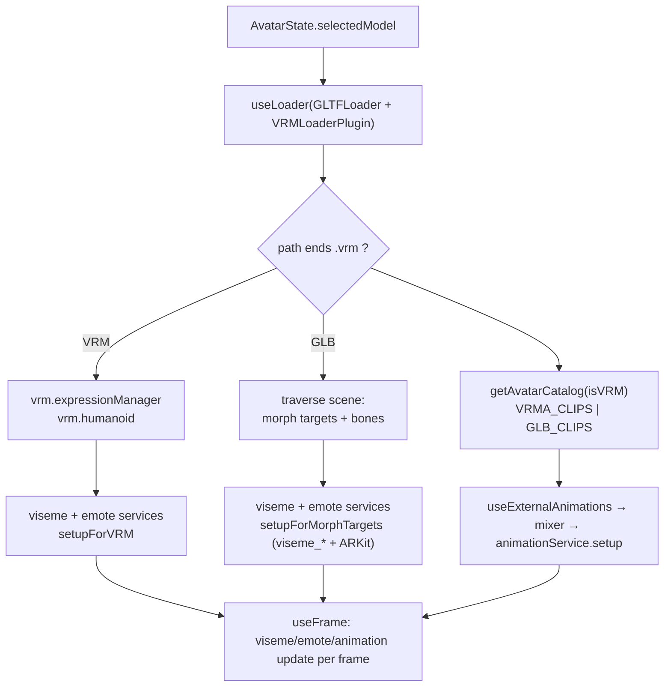
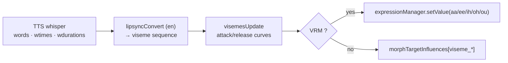
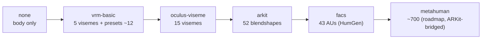
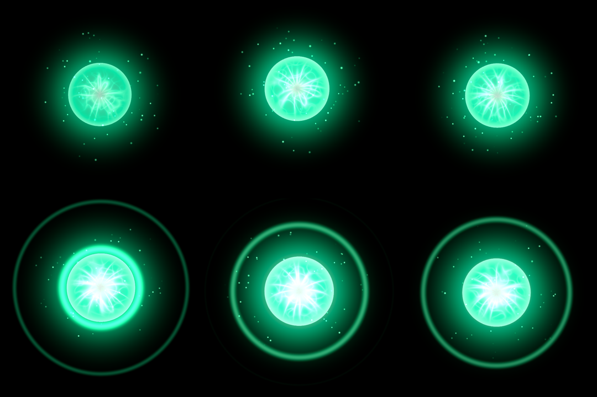
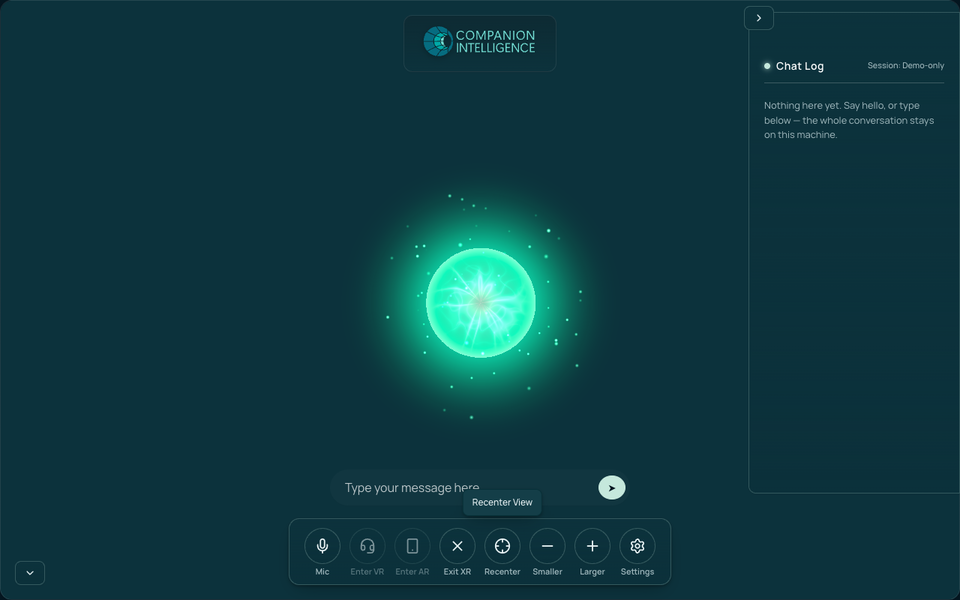

# Avatar — Rig, Face Systems, Catalog & Pipeline

How an avatar loads, what its rig must provide, the **face** puppetry (visemes + emotes),
the catalog of shippable avatars, and the Blender→VRM pipeline that produces new ones.
Body animation is in [`animation.md`](animation.md); the big picture in [`architecture.md`](architecture.md).

Code: `packages/core/src/components/scene/avatar/` (`AvatarModel.tsx`, `AvatarOptions.ts`),
`services/visemes/`, `services/emote/`, `services/face/` (capability tiers), `pipeline/`.

## Loading an avatar

`AvatarModel` loads the selected model, detects VRM vs GLB, wires the face services to
whatever the rig exposes, and loads the animation catalog for that skeleton. Selecting a
new model remounts cleanly (fresh refs/effects).

## The rig contract

What a model must carry to lip-sync + emote + animate. Two families:

| | GLB (RPM / Mixamo / HumGen-GLB) | VRM (VRoid / Reallusion / HumGen-VRM) |
|---|---|---|
| **Body rig** | RPM bones: `Hips, Spine, Spine1, Spine2, Neck, Head, LeftEye, RightEye`, arm/leg chains | VRM **humanoid** bones (mapped) |
| **Animation** | shared `GLB_CLIPS` target RPM bone names directly | `VRMA_CLIPS` retargeted via the humanoid map (`@pixiv/three-vrm-animation`) |
| **Visemes** | 14 Oculus `viseme_*` morph targets (prefix mandatory) | 5 VRM mouth expressions `aa/ee/ih/oh/ou` |
| **Emotes** | ARKit-52 morph targets (eye/brow/mouth/cheek/jaw/nose) | VRM expression presets + custom expressions |

VRM0 files auto-migrate to VRM1 expression names via `@pixiv/three-vrm`
(`a→aa, i→ih, u→ou, e→ee, o→oh`; `joy→happy, sorrow→sad, fun→relaxed`).

## Face system A — visemes / lip-sync

`whisper (word timings) → visemesSequence → visemesUpdate → visemesToRig`, driven by TTS.
The service auto-detects the rig and drives the richest viseme set it has.

- **GLB / Oculus (14):** `viseme_PP FF TH DD kk CH SS nn RR aa E I O U`
- **VRM (5):** `aa ee ih oh ou` — GLB's 14 collapse to these via `convertToVRMTarget`

## Face system B — emotes / mood

`EmotionType` → a `FacialTarget` (ARKit-vocabulary channels) + head/gaze, with automatic
blink, gaze, and facial ticks, and a barge-in relax. `EmotionType` =
`neutral · happy · angry · sad · fear · disgust · love · sleep · alert`.

| Emotion | Signature facial channels (from `moodConfigurations`) |
|---|---|
| happy | `mouthSmile 0.6` |
| angry | `browDownL/R 0.6`, `mouthFrownL/R 0.7`, `jawForward 0.3`, `handFist 1` |
| sad | `browInnerUp 0.6`, `eyeSquintL/R 0.7`, `mouthFrownL/R 0.8`, `mouthPucker 0.5` |
| neutral | `eyesLookDown 0.1` (resting) |

`FacialTarget` is essentially the **ARKit-52** blendshape set (eyeBlink*, browInnerUp,
mouthSmile, jawForward, cheekSquint*, noseSneer*, …). See the tiers below.

## Facial capability tiers

Heads carry different amounts of facial detail; `services/face/` detects the richest tier
a loaded head can drive and the driver maps a common (ARKit-52) vocabulary onto it.
Full plan: [`FACIAL-ANIMATION-PLAN.md`](FACIAL-ANIMATION-PLAN.md).

| Tier | Channels | Heads |
|---|---|---|
| `vrm-basic` | ~12 | VRoid / legacy VRM |
| `oculus-viseme` | 15 | GLB with `viseme_*` |
| `arkit` | 52 | RPM pro models, HumGen (`prepare_for_arkit`), HumGen-VRM custom expressions |
| `facs` | 43 | HumGen native (authoring) |
| `metahuman` | ~700 | roadmap — license unblocked 2025, ARKit-52 bridge |

> **VRM facial expressiveness is per-avatar, and the tier alone doesn't capture it.** A `vrm-basic`
> head only *animates* its face if its expression presets carry real morph **binds**. Anime/VRoid VRMs
> (**Yuki, Kenji**) bind happy/angry/sad/surprised/relaxed + the five visemes and express clearly;
> some realistic imports (**Erik**) declare the preset names but bind them to nothing (≈7 unnamed
> morphs) — `expressionManager.setValue('happy', 0.8)` succeeds and `update()` runs, but the mesh
> doesn't move, so the face reads as neutral. Helmeted VRMs (Maya = Sport Woman) occlude the face
> entirely. GLB (`arkit`/`oculus-viseme`) heads drive morph influences directly and always express.
> The [visual-tests faces page](visual-tests/faces.md) uses Yuki/Kenji for VRM faces; Erik is body-only.

## The avatar catalog

`AvatarOptions` (24 selectable): **14 GLB pro/RPM models** (default `Greg`), **10 legacy
VRMs**, and the **HumGen pipeline avatar `Aria`** (native VRM).

| Family | Examples | Facial tier |
|---|---|---|
| GLB — CI pro (`25-1-3_*`) | Greg (default), Ash, Cara, Jack, Courtney, Shanee, Brad, … | arkit |
| GLB — RPM / misc | Anselm / RPM-Mixamo-T-Pose, Unbranded Woman | oculus-viseme / arkit |
| GLB — one-morph | Brit, Liam, Liam CES | none (two morphs: `mouthOpen`, `mouthSmile`) |
| VRM — legacy | Work Boy, Casual Person, Erik, Yuki, Sport Woman, Casual Man, Scout, Maya, Sport Boy, Kenji | vrm-basic |
| HumGen — native VRM | **Aria** | arkit (ARKit-52 as VRM custom expressions) |

`Greg` is the default because it is fully rigged (ARKit morphs + Oculus visemes), so the
out-of-box companion lip-syncs and emotes.

The **one-morph** heads (Brit, Liam, Liam CES) carry only `mouthOpen` and `mouthSmile`, read from
their GLB files. Speech can open the mouth and nothing else: the acoustic tier writes `jawOpen`,
which reaches `mouthOpen` through the rig's legacy alias, and the timed tiers' `viseme:` keys are
folded onto the same jaw (`packages/engine/src/face/rigs/visemeFold.ts`), so the jaw follows the
words rather than the loudness. No path writes `mouthSmile`, so emotes do not smile on these heads.

## Drawn avatars: the Green Orb

Not every avatar is a model file. **Green Orb** is a floating ball of light in CI phthalo, drawn in code
(`packages/core/src/components/scene/avatar/orb/`). It is in the Settings **Character** list like any model, and its
source is the token `orb:green` rather than a URL. `ORB_AVATAR_OPTIONS` holds the drawn avatars apart from
`AvatarOptions`, because `scripts/pack-assets.mjs` checks every `AvatarOptions` entry against a file, and the render
matrices load each one as a model.

It has no face, so it shows the conversation with light. It reads the same signals as a model's face: the voice's
analyser (TTS, or a live talk reply) and `ConversationStatusState`.

| State | What the orb does |
|---|---|
| idle | floats about a centimetre up and down and breathes slowly |
| listening | the filaments brighten and it breathes faster |
| thinking | the filaments race and the motes spin |
| speaking | swells and glows with the voice; syllable onsets send rings out, at most one every 0.4 s |
| touched | flashes, and sends one ring |

`OrbMotion` (`orbMotion.ts`) turns those signals into a look and is unit-tested in node; `OrbAvatar` draws it with
four shaders (`orbShaders.ts`): the ball (a ray through a sphere, with ridged-noise filaments reaching out from a hot
core), a halo, the rings, and the motes. All four use premultiplied blending, so the light adds to a dark backdrop and
the ball still reads on a light one. With `prefers-reduced-motion` it neither floats nor rings, and its glow still
follows the voice.

The look follows the orb in [danieloquelis/Unity-QuestConversationalAI](https://github.com/danieloquelis/Unity-QuestConversationalAI).
None of its files are used: that orb is built from a third-party particle pack, and this one is our own code.

## The HumGen → VRM pipeline

New parametric avatars are generated headlessly in Blender (`pipeline/`) and exported as
**native VRM 1.0** — the approach that produces a coherent head (earlier RPM re-skin /
retarget attempts floated the teeth/eyes).

```mermaid
flowchart LR
  hg["HumGen3D human<br/>+ outfit + hair"] --> face["load_facial_rig →<br/>prepare_for_arkit (ARKit-52)"]
  face --> vis["derive 15 Oculus visemes"]
  vis --> hum["map Rigify → VRM humanoid bones"]
  hum --> parts["bone-parent eye/teeth meshes → head<br/>(fixes floating teeth)"]
  parts --> mat["rebuild skin/eye materials from raw color maps<br/>(fixes blotches + white eyes)"]
  mat --> rest["canonicalize humanoid rest pose<br/>(legs straight — VRMA clips don't fold them)"]
  rest --> exp["bind VRM expressions:<br/>5 visemes + presets + ARKit-52 custom"]
  exp --> vrm["export .vrm (io_scene_vrm)"]
```

Entry: `pipeline/generate_vrm.py` + `lib/vrm_export.py`. The exported `.vrm` drops into the
catalog like any VRM and is validated visually via the capture harness before shipping.
Known residual: a few extreme overhead-arm gesture clips shear the forearm; idle/talking/
gentle gestures render clean.

## Avatar switching

`AvatarModel` loads `AvatarState.selectedModel` (not a hardcoded default) and is **keyed**
by it, so switching remounts with fresh morph targets, skeleton family, and startup greet —
every catalog avatar is exercisable (and captured in the WebP gallery / render matrix).
